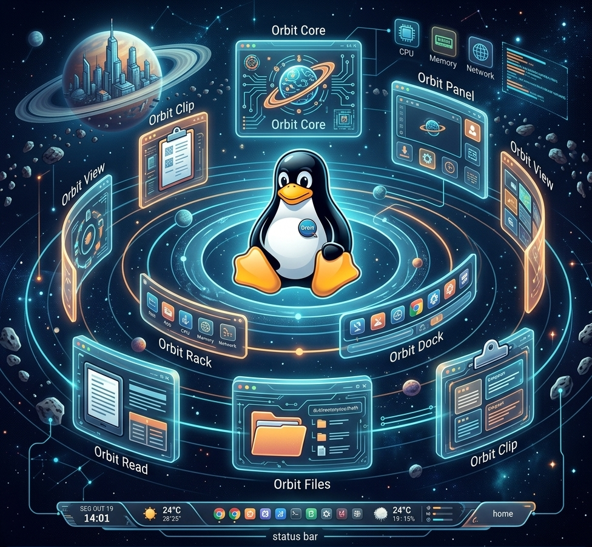

# Orbit Rack



**Orbit Rack** is a desktop for Linux written in **Rust**: the full set of
Orbit components — a Wayland compositor, a panel and a dock, and the
everyday applications around them — designed to look and behave as one.
It is part of the [JUX](https://github.com/julas23/jux) desktop suite.

> **Status:** alpha, in daily use. **orbit-core** is the only session on the
> author's laptop — it takes the screen at boot (DRM/KMS), with several
> monitors and XWayland for X programs — behind its own login and lock
> screen (orbit-greet), with switching between users. It hosts the panel,
> the dock and every application below, all working as alphas. Orbit is
> packaged as `.deb` and served from its own apt repository, the first step
> of **Orbit Linux**, the Debian-based distribution built around it. Still to
> come: orbit-aigent, the installer, and a remote edition
> (**orbit-remote-server** with **orbit-local-station**). Configuration and
> APIs may still change.

## The rack

| Component | What it is | Status |
| --- | --- | --- |
| **orbit-core** | The compositor, built on [Smithay](https://github.com/Smithay/smithay): takes the screen (DRM/KMS, libinput, libseat) or runs nested, tiles windows, floating windows and dialogs, workspaces shared by every monitor, rounded corners, Mod+drag to move and Mod+right-drag to resize, Alt+Tab and the window cards, fullscreen, idle lock, XWayland for X programs, shortcuts in `keys.yaml`, a sway-compatible IPC; hosts the panel and dock | **in daily use** |
| **orbit-greet** | Login and lock screen, one layer of the core: launched by it as its only privileged client, password through PAM (unlocking the keyring too); black while locked, the screen "opening its eyes" when unlocked; keyboard, network and battery, power buttons, the list of users | **working** |
| **orbit-login** | A small root service in place of a display manager: opens the default user's session, locked, at boot, and switches between users, the other session loading behind the lock | **working** |
| **orbit-polkit** | The polkit authentication agent, in the greet's look | **working** |
| **orbit-prompter** | The keyring's password prompts (gnome-keyring), in the greet's look, in place of gcr-prompter | **working** |
| **orbit-run** | Type a command and run it (Mod+R): Tab completes programs then files, history | **working** |
| **orbit-panel** | Panel with independent modules (clock, calendar, weather, tray, windows…) | **working** |
| **orbit-dock** | Application launcher dock | **working** |
| **orbit-notify** | Notification server in place of dunst: bubbles, a centre grouped by app, do not disturb, the panel's bell | **working** |
| **orbit-view** | Universal image viewer: every format in a sandbox, zoom, thumbnails, EXIF, slideshow | **working** |
| **orbit-read** | PDF, Markdown and plain-text reader: outline, thumbnails, search, night mode | **working** |
| **orbit-files** | File manager: Yazi's speed, three views, two panes, preview, bulk rename, actions, archives, network | **working** |
| **orbit-play** | Video and audio player for practically every format, and Flash movies through Ruffle | **working** |
| **orbit-pathfinder** | Private web browser on WebKitGTK: a sidebar of services in groups (Wavebox's layout), each in storage of its own, unread counts (Ferdium recipes) and notifications, EasyList/EasyPrivacy blocking, idle services hibernated, tracking parameters stripped, no telemetry | **working** |
| **orbitctl** | Commands and queries to orbit-core (and sway), as `swaymsg`: `orbitctl workspace number 2`, `orbitctl -t get_tree` | **working** |
| orbit-aigent | Voice layer for coding agents (Claude Code, Codex CLI, Gemini CLI, OpenCode, Kimi Code): Whisper (speech-to-text) and Piper (text-to-speech) | planned |
| **orbit-clip** | Clipboard history for Wayland and XWayland: text and images, search | **working** |
| **orbit-blink** | Screen capture: the whole screen, the current window or a selected area | **working** |
| **orbit-calc** | Calculator: standard, scientific, financial (HP-12C) and IPv4 subnet profiles | **working** |
| **orbit-edit** | Text and code editor: several cursors, column selection, indent guides and folding, folder sidebar, session | **working** |
| **orbit-term** | Terminal with the prompt fixed on top (date, exit code, git status, directory) and Tab completion; each output fills a box that never wraps, the last 50 that worked kept in a list; interactive programs run in a real terminal (VTE) | **working** |
| **orbit-safe** | The keyring's passwords (Secret Service, in place of Seahorse) and one-time codes (TOTP), opened with what `/etc/pam.d/orbit-safe` asks: the password, a fingerprint, the face, a code | **working** |
| orbit-install | The Orbit Linux installer | planned |
| orbit-remote-server, orbit-local-station | The remote edition (see [below](#orbit-remote-server-and-orbit-local-station)) | planned |

Orbit is its own code. Existing desktops and compositors are studied as
references; where orbit-core takes code from one (cosmic-comp, niri, anvil,
sway), the file says where it came from and keeps that project's licence —
code from cosmic-comp is GPL-3.0-only, so the orbit-core binary is too, while
the rest of Orbit stays GPL-3.0-or-later (see `docs/PLANO-CORE.md`, section 9).

## Progress

Every component of Orbit. **Progress** is how much of what is planned for it
is built; **functional** is how much of what is built works in daily use.
Both go from red (0%) to green (100%) in ten steps. **Version** is the
version number with its stage: , , , .

### Session and compositor

| Component | What it is | Progress | Functional | Version |
| --- | --- | :-: | :-: | :-: |
| **orbit-core** | The compositor |  |  |  |
| **orbit-greet** | Login and lock screen |  |  |  |
| **orbit-login** | Sessions on the seat, user switch |  |  |  |
| **orbit-polkit** | polkit agent |  |  |  |
| **orbit-prompter** | Keyring prompts |  |  |  |
| **orbit-run** | Command line (Mod+R) |  |  |  |
| **orbitctl** | Commands to the compositor |  |  |  |
| **orbit-ipc** | i3/sway IPC protocol |  |  |  |
| **orbit-protocols** | Private Wayland protocols |  |  |  |

### Shell

| Component | What it is | Progress | Functional | Version |
| --- | --- | :-: | :-: | :-: |
| **orbit-panel** | The panel |  |  |  |
| **orbit-dock** | The dock |  |  |  |
| **orbit-notify** | Notification server |  |  |  |
| **orbit-common** | Configuration, CSS, backends |  |  |  |
| **orbit-app** | Shared startup, icons, theme, i18n |  |  |  |
| **orbit-backend-wayland** | layer-shell backend |  |  |  |
| **orbit-backend-x11** | X11 backend (EWMH, struts) |  |  |  |

### Panel modules

| Component | What it is | Progress | Functional | Version |
| --- | --- | :-: | :-: | :-: |
| `menu` | Application menu |  |  |  |
| `windows` | Open windows |  |  |  |
| `clock` | Date, time, world clocks |  |  |  |
| `calendar` | Month grid |  |  |  |
| `weather` | Current conditions |  |  |  |
| `forecast` | Next days |  |  |  |
| `tray` | System tray |  |  |  |
| `brightness` | Backlight / DDC |  |  |  |
| `volume` | Output volume |  |  |  |
| `workspaces` | Areas |  |  |  |
| `network` | Connection |  |  |  |
| `keyboard` | Layout |  |  |  |
| `battery` | Charge |  |  |  |
| `session` | Power, log out |  |  |  |
| `notifications` | The bell |  |  |  |
| `bluetooth` | Devices |  |  |  |
| `monitors` | Monitor layout |  |  |  |
| `spectrum` | Audio spectrum |  |  |  |
| `cpu, ram, gpu, lan` | Graphs |  |  |  |
| `disk` | Usage pie |  |  |  |

### Applications

| Component | What it is | Progress | Functional | Version |
| --- | --- | :-: | :-: | :-: |
| **orbit-calc** | Calculator |  |  |  |
| **orbit-clip** | Clipboard history |  |  |  |
| **orbit-blink** | Screen capture |  |  |  |
| **orbit-view** | Image viewer |  |  |  |
| **orbit-read** | PDF, Markdown, text reader |  |  |  |
| **orbit-play** | Video and audio player |  |  |  |
| **orbit-edit** | Text and code editor |  |  |  |
| **orbit-files** | File manager |  |  |  |
| **orbit-term** | Terminal |  |  |  |
| **orbit-pathfinder** | Web browser |  |  |  |
| **orbit-aigent** | Voice layer for coding agents |  |  |  |
| **orbit-safe** | Passwords and TOTP codes |  |  |  |

### Orbit Linux

| Component | What it is | Progress | Functional | Version |
| --- | --- | :-: | :-: | :-: |
| **Packages (.deb)** | `distro/build-debs.sh`, metapackages, defaults, fonts, Ruffle |  |  |  |
| **apt repository** | aptly on the LXC, nightly sync |  |  |  |
| **CI** | Builds the debs on Debian 13 (publishing stays at home) |  |  |  |
| **orbit-studio** | ArtCraft metapackage |  |  |  |
| **orbit-install** | The installer |  |  |  |
| **ISO** | Offline live ISO, EFISTUB, Plymouth |  |  |  |

### Remote edition

| Component | What it is | Progress | Functional | Version |
| --- | --- | :-: | :-: | :-: |
| **orbit-remote-server** | orbit-core's sharing layer: the session streamed (Rust + Slint) |  |  |  |
| **orbit-local-station** | Slint client pulling the server's greeter and session |  |  |  |

## Principles

- **Native and event-driven.** Data arrives by events — compositor IPC,
  D-Bus, PipeWire, kernel notifications — or internal timers. Nothing polls by
  spawning processes. The whole panel idles at about 0.1% of a CPU core.
- **Independent, optional modules.** Every part of the panel can be turned on,
  off and reordered in its configuration file.
- **Content always upright.** Text and icons are never rotated, whatever edge
  the panel is on: moving the panel changes how its content is arranged, not
  which way it faces.
- **Themeable with CSS.** The look is GTK CSS, on top of a built-in theme,
  reloaded live when saved.
- **One process per surface.** The panel and the dock run separately, so a
  crash in one leaves the other running.
- **Follows the system.** Light or dark and the accent colour come from the
  desktop (XDG portal) and switch live; the language comes from the locale.

## Orbit-Core

The compositor and the session. Windows tile side by side in columns —
Mod+right-drag moves the line between two — or, workspace by workspace
(`layout`, Mod+Ctrl+Space for the next), as master and stack, one at a time
(monocle) or splitting each other's place (bsp); dialogs float over their
parent. Workspaces are shared by every monitor, and laid out as a grid of
areas walked with Ctrl+Alt+arrows. Shortcuts live in
`~/.config/orbit/keys.yaml`, a combination to an IPC command (`none` removes
one); the defaults, Mod being the Super key:

| Key | | Key | |
| --- | --- | --- | --- |
| Mod+Return | terminal | Mod+Space | launcher |
| Mod+R | run a command | Mod+L | lock |
| Mod+Q, Mod+Shift+Q | close, kill | Mod+F | fullscreen |
| Mod+Shift+Space, Mod+Esc | float or tile | Mod+↑ ↓ | maximize, restore |
| Mod+← → | snap to a half | Alt+arrows | focus that way |
| Mod+Ctrl+arrows | move that way | Ctrl+Alt+arrows | next area |
| Alt+Tab, Alt+Shift+Tab | windows of the workspace, of all | Mod+Tab | the window cards |
| Mod+1…0 | workspace | Mod+Shift+1…0 | move to workspace |
| Mod+drag | move a window | Mod+right-drag | resize it |
| Mod+Ctrl+Space | next layout | Mod+A | Orbit-Aigent: listen, cancel |

Each monitor can be placed, turned and scaled (fractions too) in
`core.yaml`'s `outputs:`, or for the session by wlr-randr, kanshi and the
like (wlr-output-management). Screens are shared through the portal
(xdg-desktop-portal-wlr, `orbit-portals.conf`).

## Orbit-Panel

A column (or row) of independent modules, anchored to a screen edge.

| Module | Shows | Source |
| --- | --- | --- |
| `menu` | Application menu button | — |
| `windows` | Open windows: app name and icon, area colour, focus, minimized; menu to minimize, maximize, send to an area, close. Ordered by area, then monitor and window position, top to bottom and left to right | sway IPC |
| `clock` | Date, local time with zone, a minute "hourglass" that empties, up to four world clocks | internal timer |
| `calendar` | Month as a 7 × 6 grid, weekends and today highlighted | internal timer |
| `weather` | Current conditions, min/max, sun and moon, humidity and wind | wttr.in + Open-Meteo |
| `forecast` | The next days | same as `weather` |
| `tray` | System tray (StatusNotifierItem), with application menus | D-Bus |
| `brightness` | Backlight, or an external monitor over DDC/CI | kernel + logind / ddcutil |
| `volume` | Default output volume and mute | PulseAudio protocol (PipeWire) |
| `workspaces` | Global areas, shared by all monitors | sway IPC |
| `network` | Connection name and IP/prefix; click: networking and Wi-Fi switches, the Wi-Fi networks in reach and the VPNs; right click: the connection editor | NetworkManager |
| `keyboard` | Layout language and variant; click: the next layout; right click: pick one; the wheel walks them | sway IPC |
| `battery` | Charge and uptime; click: the details and the power profile (power-profiles-daemon); right click: `manager` | UPower |
| `session` | Power off, reboot, log out — confirmed over a blurred screen | logind / sway |
| `notifications` | The bell: unread count; click: the notification centre; right click: do not disturb, clear all | orbit-notify |
| `bluetooth` | Adapter and connected devices; connect and pair | BlueZ |
| `monitors` | How many monitors and where; arrange them by dragging, remembered by orbit-core | compositor IPC |
| `spectrum` | Audio spectrum, as CAVA draws it: a line, 12 bars, or thin gradient bars on a grid | PulseAudio protocol (PipeWire) |
| `cpu`, `ram`, `gpu`, `lan` | The last minute as a graph on a grid, with clock, temperature, swap, VRAM, rates | /proc, /sys (amdgpu) or nvidia-smi |
| `disk` | A pie of used (red) and free (blue) with total, used and free; listed once per filesystem | GIO |

**Clicks.** Every module answers the same way: a left click opens the quick
part (switches and shortcuts, in a popover), a right click the full one (the
module's own application or list), and the wheel steps through a value
(volume, brightness, keyboard layout).

**Layout.** A vertical panel is a grid of 30 px cells, four columns wide,
10 px apart (154 px in all). Each module comes in up to three sizes —
**Mini**, **Normal** and **Full** — and takes a block of cells for it;
modules flow into the grid in order, the start part from the top, the end
part from the bottom. A horizontal panel is one line, each module in a *line*
form with the details in tooltips and popovers. The panel is edited in
place: a right click on an empty spot turns editing on, and modules are then
dragged, resized, moved between parts, added and removed, the result saved to
`panel.yaml`. `maintenance: true` draws the grid behind the panel.

## Orbit-Dock

A row of launchers on a screen edge, built from desktop files, in groups with
separators between them. Icons come from the icon theme or from the files the
desktop entries point to, loaded at display size. A launcher's menu has the
application's own actions and recent files, and an unread count shows on it
when the application announces one. The dock is edited in place, as the
panel: drag to reorder, drop off to remove, add launchers and separators.

An AppImage — picked with "Add AppImage…" while editing the dock, or dropped
on it — needs nothing else: its icon is taken out of it and kept next to it,
and a desktop file that runs it is written to `~/.local/share/applications`.

## Orbit-Calc

A calculator with four profiles, one tab each; it always opens on the
standard one. The window has a fixed size, each profile's own, so tiling
compositors float it.

- **Standard** and **scientific**: type an expression — with the keypad or
  the keyboard — and see its value as you type; usual precedence,
  parentheses, desk-calculator percent (`200 + 10%` is 220), trigonometry in
  degrees or radians, logarithms, powers, roots, factorial.
- **Financial**: after the HP-12C — the 12c's keyboard and RPN stack, with its gold (f) and blue
  (g) functions: time value of money (n, i, PV, PMT, FV, BEGIN/END, 12×,
  12÷), amortization, simple interest, cash flows with NPV and IRR,
  depreciation (SL, SOYD, DB), bond price and yield, statistics and linear
  estimates, dates (DATE, ΔDYS, D.MY/M.DY) and the STO/RCL registers.
  Programming (P/R, R/S, GTO…) is not implemented.
- **IPv4 subnet**: an address with a prefix or mask in, its mask, wildcard,
  network, broadcast, host range and count, class, kind (private, CGNAT,
  loopback…) and binary form out.

Numbers follow the language: `1.234,5` in Portuguese, `1,234.5` in English.

## Orbit-Clip

A clipboard history. It runs in the background and keeps what is copied —
text and images, from Wayland and X11 (XWayland) applications alike — in a
history that survives restarts (`~/.local/share/orbit/clip/`). Launching it
again shows or hides the history: typing searches it, Enter or a click puts
an item back in the clipboard, ready for Ctrl+V; Delete removes one.

It can keep the clipboard and the primary selection (mouse selection,
middle-button paste) in sync, and leaves out what password managers mark as
secret. Options in `~/.config/orbit/clip.yaml` (see
[`examples/orbit/clip.yaml`](examples/orbit/clip.yaml)). It needs a
compositor with `wlr-data-control` (sway, Hyprland, river, labwc…).

In sway:

```
exec orbit-clip --background
bindsym $mod+v exec orbit-clip
```

## Orbit-Blink

Screen capture: the whole screen, the focused window, or an area chosen on a
frozen picture of the screens. Each capture is saved in `$HOME`, copied to the
clipboard, and shown on a card with a thumbnail and buttons to copy it again
(if something else was copied since) or save a copy elsewhere. Without a
mode it opens an options window (mode, delay, whether to include the
cursor). It needs a compositor with `wlr-screencopy` and a sway-compatible
IPC (for the layout of the screens and windows): orbit-core or sway.

```
bindsym Print       exec orbit-blink screen
bindsym Shift+Print exec orbit-blink area
bindsym $mod+Print  exec orbit-blink
```

## Orbit-View

An image viewer. The image fills the window and the controls show while the
pointer moves. Opening an image lists its folder — arrow keys, the buttons or
a strip of thumbnails go through it, and the list follows files added or
removed there. The wheel or a pinch zooms around the pointer, dragging pans,
a double-click switches between fitted and actual size. It turns and mirrors
images and saves that into JPEG files (by changing only the orientation tag
when there is one) and PNG files; shows the file's and the camera's details
(EXIF: date, camera, exposure, place with a map link); plays animations and
slideshows (F5); copies the image; and sends files to the trash (Delete).

Every format is decoded by [glycin](https://gitlab.gnome.org/GNOME/glycin) —
the engine of GNOME's Loupe — each in a sandbox, so a malformed file can only
crash its loader: PNG, JPEG, GIF, WebP, AVIF, HEIC, JPEG XL, SVG, TIFF, QOI,
OpenEXR and more, as installed (`glycin-loaders`). Thumbnails share the
freedesktop.org cache with file managers. Options in
`~/.config/orbit/view.yaml` (see
[`examples/orbit/view.yaml`](examples/orbit/view.yaml)).

| Key | | Key | |
| --- | --- | --- | --- |
| ← → Space | previous, next | + − | zoom in, out |
| Home End | first, last | 0 1 | fit, actual size |
| R, Shift+R | turn right, left | H V | mirror |
| Ctrl+S | save the turn | Ctrl+C | copy |
| I | information | F5 | slideshow |
| F11 or F | full screen | Delete | to the trash |

## Orbit-Read

A reader for PDF, Markdown and plain text; documents open at the top.

- **PDF**, drawn by [poppler](https://poppler.freedesktop.org/): pages one
  under another, fitted to the width or zoomed (Ctrl + wheel); a sidebar
  with the outline, when the document has one, and the pages; search with
  every match marked (Ctrl+F, Enter / Shift+Enter); text selected by
  dragging and copied with Ctrl+C; links followed, inside the document or
  out; night mode, which turns the pages' colours over and keeps their hues
  (Ctrl+I); printing (Ctrl+P); and a password asked for when the file has
  one. Only the pages on screen are rendered, so long documents open at
  once.
- **Markdown**, laid out: headings, emphasis, lists and task lists, quotes,
  code, tables, local images, links (to other documents, which open in the
  reader, and to headings in the page) and footnotes; Ctrl+U shows the
  source.
- **Plain text** in a monospaced font, UTF-8 or Latin-1.

The text keeps to a comfortable width, centred; Ctrl + / − / 0 changes its
size.

## Orbit-Play

A player for video and audio, on [GStreamer](https://gstreamer.freedesktop.org/)
with FFmpeg's decoders behind it (`gstreamer1.0-libav`), so practically
every format plays — MKV, MP4, WebM, AVI, FLV, WMV, RMVB, MP3, FLAC, Opus…
— decoded on the GPU where it can (VA-API). The picture is drawn into the
window by GTK; audio shows the album's cover, title and artist.

The folder is a playlist: previous and next, and on to the next when one
ends. Audio tracks and subtitles — embedded, the file of the same name
beside the video (`filme.srt`, `filme.pt-BR.srt`), or one chosen — speed
from 0.25× to 2×, frame by frame. The controls go a moment after the
pointer stops while a video plays.

Old **Flash movies** (`.swf`) are not video: they are handed to
[Ruffle](https://ruffle.rs/), the Flash Player emulator, in a window of its
own (`ruffle` in `~/.local/bin` or on the PATH).

| Key | | Key | |
| --- | --- | --- | --- |
| Space | play, pause | ← → | 5 s back, on (Shift: 60 s) |
| ↑ ↓ | volume | M | mute |
| , . | frame back, on | [ ] Backspace | slower, faster, normal |
| PgUp PgDn | previous, next | F or F11 | full screen |

## Orbit-Edit

A text and code editor on [GtkSourceView](https://gitlab.gnome.org/GNOME/gtksourceview):
highlighting for hundreds of languages, line numbers, auto-indentation,
search and replace with regular expressions, the minimap. Of its own:

- **Several cursors.** Ctrl+D selects the word, then adds the next
  occurrence; Ctrl+click adds a cursor; Alt+drag selects a column, a cursor
  per line. What is typed at one goes in at all — dead keys and input
  methods too — and so do Backspace, Delete, Enter, the arrows, copy and
  paste (a line per cursor when the counts match). Escape: back to one.
- **Indentation.** Guides at every level, through blank lines; blocks fold
  by indentation from the arrow in the margin or Ctrl+Shift+[ / ]. A
  file's own indentation — tabs, or how many spaces — is read from it.
- **The folder** in a sidebar (Ctrl+B), and Ctrl+P to open a file of it by
  a few letters of its path.
- **The session.** Closing never asks: the tabs, their cursors and any
  unsaved text come back next time (`~/.local/state/orbit/edit/`).
- Ctrl+/ comments lines in or out; Ctrl+G goes to a line; the status line
  shows and changes the indentation and the language; UTF-8 or Latin-1
  and LF or CRLF are kept as found. Options in `~/.config/orbit/edit.yaml`.

## Orbit-Files

A file manager with [Yazi](https://yazi-rs.github.io/)'s speed in a window,
and the best of Thunar, Caja, Nautilus, Konqueror and Nemo.

- **Fast.** A folder is read on a thread — one `readdir` and one `lstat`
  per entry, the type guessed from the name — and fills in as it is read:
  fifty thousand files list and sort in about 0.2 s, the window never
  waits. A monitor keeps it current entry by entry.
- **Three views of one folder**, switched with Ctrl+1/2/3: a list with
  sortable columns; icons with thumbnails (the shared thumbnail cache, or
  the system's thumbnailers: images, videos, PDFs); and Yazi's columns —
  the parent folder, the folder, and a preview of the selection (images,
  text highlighted, a PDF's first page, video and audio to play, a
  folder's contents).
- **Tabs and two panes** (F10); F5 / F6 copy or move to the other pane or,
  with one pane, to a folder chosen in a dialog.
- **Selection** with a box on every entry, Ctrl+click or Ctrl+Space for one
  more (or one less), Shift+click or Shift+arrows for a run, Ctrl+A all,
  Ctrl+I the rest instead.
- **The function keys** as in Total Commander: F1 the keys, F2 rename, F3
  find, F4 edit (text in Orbit-Edit), F5 copy, F6 move, F7 new folder, F8 to
  the trash, F9 view (in Orbit-View, Orbit-Read or Orbit-Play), F10 two
  panes, F11 full screen, F12 a terminal here.
- **Places**: home and the user's folders, GTK bookmarks, the trash, disks
  (mount, eject) and *Connect to server* — SMB, SFTP, FTP, WebDAV through
  GVfs, with the password asked for. Under "Devices", volumes only:
  folders a server mounts into home (NFS, bind mounts) are left out unless
  `devices: all` is set in `~/.config/orbit/files.yaml`. Below the places,
  the selection's thumbnail, name and size.
- **The mouse's back and forward buttons** go through the history.
- **Copy, move, trash, delete** on threads, with progress and a stop
  button; a file already there asks: skip, keep both, replace (or all).
  Cut, copy and paste go to and from Nautilus, Thunar, Nemo and PCManFM;
  drag and drop moves within a disk and copies across (Ctrl copies, Shift
  moves).
- **Rename** in place (F2), or many at once as Thunar does: find and
  replace with regular expressions, numbering from a pattern, text before
  or after, case — every new name shown before anything changes.
- **Actions** of your own in the context menu, as Thunar's and Nemo's
  ([`examples/orbit/files-actions.yaml`](examples/orbit/files-actions.yaml)),
  and **archives**: compress to zip, tar.gz, tar.xz, tar.zst or 7z; extract
  here.

| Key | | Key | |
| --- | --- | --- | --- |
| j k, ↓ ↑ | down, up | h l, ⌫ ⏎ | up a folder, open |
| gg G | first, last | Space | mark and go on |
| yy dd pp | copy, cut, paste | / or Ctrl+F | find (filter) |
| Ctrl+C X V | copy, cut, paste | F2 | rename (many: bulk) |
| Delete | to the trash | Shift+Delete | delete for good |
| Alt+← → ↑ | back, forward, up | Ctrl+L | type a path or `smb://…` |
| Ctrl+H | hidden files | Ctrl+T, Ctrl+W | new tab, close tab |
| Ctrl+click, Ctrl+Space | one more or less | Shift+click, Shift+↑ ↓ | a run |
| Ctrl+A | select all | Ctrl+I | invert the selection |
| F1 | the keys | F3 | find in the folder |
| F4 | edit | F5, F6 | copy, move (other pane or a folder) |
| F7 | new folder | F8, Shift+F8 | to the trash, delete for good |
| F9 | view | F10 | two panes |
| F11 | full screen | F12 | a terminal here |
| Ctrl+R | read the folder again | | |

## Orbit-Term

A terminal whose prompt is part of the window: it stays at the top, and
outputs never mix with it. Each command's output fills the box below,
never wrapped — scrolled both ways — in its colours; the last 50 that
worked (exit code 0 and nothing on stderr) are listed on the right, a
click showing one again (`~/.local/state/orbit/term/`).

Commands run in one shell session that loads `~/.shell/*.sh` (or
`~/.bash_aliases`): `cd`, `export` and aliases hold from one command to the
next. Interactive programs — editors, `htop`, `less`, `ssh`, `sudo`… (the
built-in list plus `interactive:` in `term.yaml`), or any command run with
Ctrl+Enter — run in a real terminal (VTE) that takes the output's place and
the keyboard until they end. ↑ ↓ walk the commands run before, Ctrl+C
interrupts (twice: kills), Ctrl+L clears the output; `font:` in `term.yaml`
sets the font.

## Building and running

**From packages.** Orbit is packaged as `.deb` (`distro/build-debs.sh`) and
served from its public apt repository, **https://rationalazimuth.com/orbit**,
for Debian 13 (trixie) on amd64. Add its key and source, and a Debian 13
system becomes Orbit:

```sh
curl -fsSL https://rationalazimuth.com/orbit/orbit-archive-keyring.gpg \
  | sudo tee /usr/share/keyrings/orbit-archive-keyring.gpg >/dev/null
echo "deb [signed-by=/usr/share/keyrings/orbit-archive-keyring.gpg] https://rationalazimuth.com/orbit trixie main" \
  | sudo tee /etc/apt/sources.list.d/orbit.list
sudo apt update
sudo apt install orbit-desktop     # the whole session: core, login, panel, dock and every application
```

Or only some programs, e.g. `sudo apt install orbit-panel orbit-dock` on
another compositor, or `orbit-files`, `orbit-term`, `orbit-view`… one by
one. Every Orbit package has the same version (`0.1.0+git<date>.<commit>`),
so `sudo apt upgrade` keeps them in step. The rest comes from Debian's own
repositories. The public repository carries only Orbit's packages: the
metapackages that need third-party ones (`orbit-apps`, `orbit-media`,
`orbit-studio`, `orbit-dev`) are only in the full repository of
[Orbit Linux](#orbit-linux). The key is still a pre-release one ("Orbit Linux
Archive (pre-release)") and may be replaced before 1.0.

**From source.** Requirements: Rust 1.92+, GTK 4.12+ and `gtk4-layer-shell` development files;
for Orbit-View also the `libseccomp` development files, glycin's loaders and
bubblewrap (its sandbox); for Orbit-Read the poppler-glib development
files; for Orbit-Play GStreamer's (core, base and bad plugins) and
`gstreamer1.0-libav`; for Orbit-Edit GtkSourceView 5's; for Orbit-Term VTE's
(GTK 4). Orbit-Files uses
GVfs for network shares and zip, unzip, tar and 7z for archives.
On Debian/Ubuntu:

```sh
sudo apt install libgtk-4-dev libgtk4-layer-shell-dev libseccomp-dev glycin-loaders bubblewrap libpoppler-glib-dev \
  libgstreamer1.0-dev libgstreamer-plugins-base1.0-dev libgstreamer-plugins-bad1.0-dev gstreamer1.0-libav \
  libgtksourceview-5-dev libvte-2.91-gtk4-dev gvfs-backends p7zip-full unzip zip
cargo build --release
./target/release/orbit-panel &
./target/release/orbit-dock &
```

Start the panel first. Each surface reserves its edge (layer-shell exclusive
zone) and the compositor lays them out in the order they appear: a left
panel started first keeps the full height, and a top dock started after it
takes the top edge to the right of the panel.

To install into `~/.local/bin` and start both in the right order from the
compositor's configuration:

```sh
scripts/install.sh                 # builds and installs every program and orbit-session into ~/.local/bin
orbit-session                      # (re)starts the panel, then the dock
orbit-session --fallback 'eww …'   # runs another panel if Orbit cannot start
```

In sway, e.g. `exec ~/.local/bin/orbit-session` — and set `gaps top`/`gaps
left` to 0 if they were reserving room for another panel: Orbit reserves its
own.

Runtime: orbit-core, or another Wayland compositor with `wlr-layer-shell`
(Orbit was first developed on sway; the `windows`, `workspaces` and
`monitors` modules talk to a sway-compatible IPC, which orbit-core provides). Optional: `grim` for
the blurred confirmation screen, `ddcutil` for external-monitor brightness.
The panel and dock also have an X11 backend (EWMH dock hints and struts),
tested on bspwm in earlier versions.

## Orbit Linux

A distribution built around Orbit: **Debian 13 plus the Orbit repository**,
never a fork of Debian — kernel, drivers, security and firmware stay
Debian's. The plan (in Portuguese) is in
[`docs/PLANO-DISTRO.md`](docs/PLANO-DISTRO.md).

- **Packages.** Every Orbit program is a `.deb`, and metapackages gather
  them: `orbit-desktop` (core, panel, dock, the applications, sound,
  network, portals), `orbit-studio` (the [ArtCraft](https://github.com/storytold)
  suite — GridCraft, WordCraft, DeckCraft, VectorCraft, PhotoCraft,
  EffectCraft, LightCraft, SoundCraft, FigCraft, FilmCraft, DesignCraft,
  CADCraft, PdfCraft — beside the classics it may one day replace),
  `orbit-apps`, `orbit-media` and `orbit-dev`.
- **Repository.** Built with aptly from the lists in
  [`distro/repo/`](distro/repo): the part of Debian 13 Orbit uses, with every
  dependency and the security updates; Orbit's own packages; ArtCraft's and
  other projects' official `.deb` releases; the newest VS Code and Firefox.
  Signed, synced every night, and self-sufficient: a system debootstraps and
  installs every metapackage from it alone. Running on the author's network
  for now; its Orbit part (`orbit-public`: Orbit's packages without the
  metapackages in [`public.exclude`](distro/repo/public.exclude)) is copied
  by `distro/repo/push-public.sh` to the public repository,
  https://rationalazimuth.com/orbit (how to use it: [Building and
  running](#building-and-running)).
- **Installation.** A live ISO with one screen and an **INSTALL** button
  (orbit-install, in Rust and GTK like the rest), offline: disk, hostname,
  user and password, and which metapackages. Boot is EFISTUB with a unified
  kernel image — no boot loader — with a Plymouth splash, into orbit-greet
  and orbit-core. **An existing `/home` is never erased:** a partition that
  clearly holds `/home` (plain, LVM, LUKS or a btrfs subvolume) is kept as it
  is; on a single partition with `/` and `/home` together, everything but
  `/home` is deleted and Orbit installs there. Wiping everything and starting
  from scratch is always offered too. The new user gets the old home's
  owner's id.
- **Status.** Packages, repository and orbit-greet done; the installer and
  the ISO are next.

## orbit-remote-server and orbit-local-station

A later, remote edition of Orbit Linux, in the spirit of LTSP, made of a pair
that works only together:

- **orbit-remote-server:** a sharing layer of orbit-core, not a second
  Orbit: a separate process the core hands its frames to (straight from the
  GPU) and takes the remote keyboard, mouse and gamepads from. The session
  is the real one, every application included, so an Orbit machine can sit
  at home or in the cloud and be used from anywhere. First it mirrors the
  screens; then the client gets a screen of its own resolution in the same
  session, the local screens locked meanwhile (`serve --virtual` makes that
  screen today; the locking is to come).
- **orbit-local-station:** no local interface of its own; it pulls the
  greeter, and then the whole session, straight from the server; the greet
  of a full Orbit machine chooses between its local desktop and a remote
  one.
- **Now:** pairing by a code shown on the server (only while its session is
  unlocked), a token kept after; the video (VA-API or NVENC, H.264) and the
  sound (Opus) over WebRTC; the client's keys and mouse back, the core
  keeping Ctrl+Alt+Backspace and the console switches from them.
- **Clients:** in Rust and [Slint](https://slint.dev) — a web page in any
  browser, the station (drawn straight on the screen, no compositor) and,
  much later, Android and iOS. The desktop applications stay GTK4.
- **Media:** GStreamer with the GPU's encoders (VA-API) over WebRTC, decoded
  on the client's GPU; sound both ways, the microphone and webcam going up to
  the server as PipeWire devices. The target is the latency of
  Sunshine + Moonlight: 20 ms or less on the local network.
- **Storage:** a USB drive or external disk plugged into the device in hand
  (TV, phone, stick) is seen and used by Orbit; the user's whole environment
  could even live on that disk and travel with them.
- **Why:** it would replace the Sunshine/Moonlight streaming used today to
  reach a remote machine.
- **Testing:** the think and a VM are its first test machines.

## Configuration

Everything lives in `~/.config/orbit/` (or the directory given with
`--config DIR`), one file per part:

```text
~/.config/orbit/
├── panel.yaml        edge, size, monitor, maintenance, and the module lists
├── dock.yaml         the dock and its launchers
├── style.css         user stylesheet, on top of the built-in theme
└── modules/
    ├── clock.yaml    one optional file per panel module
    ├── weather.yaml
    └── …
```

Every file and every key is optional. A module is turned on by listing it in
`panel.yaml` under `start`, `center` or `end`, in display order. A module that
is unknown or whose file has an error is left out with a message in the log;
the rest of the panel still starts. [`examples/orbit/`](examples/orbit) has
every key, and [`examples/maintenance/`](examples/maintenance) runs the panel
and dock on a second monitor with the layout grid shown:

```sh
./target/release/orbit-panel --config examples/maintenance &
./target/release/orbit-dock --config examples/maintenance &
```

The weather pictures (from the brweather themes) are not distributed here;
point `icon_dir` in `modules/weather.yaml` at them, or Nerd Font glyphs are
used instead.

## Colours and languages

**Colours.** The panel and the dock use a dark or a light palette
([`data/palette-dark.css`](data/palette-dark.css),
[`data/palette-light.css`](data/palette-light.css)) following the system's
`color-scheme`, and the system's `accent-color` when it has one — both read
from the XDG desktop portal, and changed live. With no preference, the GTK
theme decides (`GTK_THEME`, else the configured theme; "…-dark" means dark).
Every colour is a named `@orbit_*` colour that `style.css` can redefine.

**Languages.** Text is translated with [Fluent](https://projectfluent.org/):
one file per language in [`data/i18n/`](data/i18n), English
([`en-US.ftl`](data/i18n/en-US.ftl)) being the source and the fallback. The
language comes from `LC_ALL`, `LC_MESSAGES` or `LANG`. To translate Orbit,
copy `en-US.ftl` to your locale (e.g. `de-DE.ftl`), translate the text after
each `=`, and add the file to `CATALOGS` in
[`crates/orbit-app/src/i18n.rs`](crates/orbit-app/src/i18n.rs); a test checks
that every catalog has every message. Dates, weekdays and months already
follow the locale.

## Project layout

| Crate | Purpose |
| --- | --- |
| `orbit-common` | Configuration, CSS loading, display-backend abstraction |
| `orbit-backend-wayland` | Wayland backend: layer-shell |
| `orbit-backend-x11` | X11 backend: EWMH dock type, struts and positioning |
| `orbit-app` | Startup shared by the panel, the dock and the applications; icons, theme, translations |
| `orbit-panel` | The panel and its modules |
| `orbit-dock` | The dock |
| `orbit-calc` | The calculator |
| `orbit-clip` | The clipboard history |
| `orbit-blink` | The screen capture |
| `orbit-view` | The image viewer |
| `orbit-read` | The document reader |
| `orbit-play` | The media player |
| `orbit-edit` | The text editor |
| `orbit-files` | The file manager |
| `orbit-pathfinder` | The web browser |
| `orbit-term` | The terminal |
| `orbit-notify` | The notification server |
| `orbit-run` | The command line (Mod+R) |
| `orbit-core` | The compositor |
| `orbit-greet` | The login and lock screen |
| `orbit-login` | The sessions on the seat, and the switch between users |
| `orbit-polkit` | The polkit authentication agent |
| `orbit-prompter` | The keyring's password prompts |
| `orbit-protocols` | Orbit's private Wayland protocols (`orbit_greet_v1`) |
| `orbit-ipc` | The i3/sway IPC protocol: served by orbit-core, spoken by the panel, the applications and orbitctl |
| `orbitctl` | Commands to the compositor |
| `distro/` | Packaging: `build-debs.sh`, the metapackages, the apt repository's lists and sync |

The plans (in Portuguese) are in [`docs/`](docs): the panel
([`PLANO-PAINEL.md`](docs/PLANO-PAINEL.md)), the compositor
([`PLANO-CORE.md`](docs/PLANO-CORE.md)), notifications
([`PLANO-NOTIFY.md`](docs/PLANO-NOTIFY.md)), the browser
([`PLANO-PATHFINDER.md`](docs/PLANO-PATHFINDER.md)) and the distribution
([`PLANO-DISTRO.md`](docs/PLANO-DISTRO.md)).

## Contributing

Ideas and feedback are welcome. The project is young: please open an issue to
discuss larger changes before a pull request.

## License

Orbit Rack is licensed under the
[GNU General Public License, version 3 or any later version](LICENSE).

`data/pathfinder/recipes` holds the recipes of
[ferdium-recipes](https://github.com/ferdium/ferdium-recipes), under the MIT
license ([its text](data/pathfinder/recipes/LICENSE.md)). The block lists
(EasyList, EasyPrivacy) are not shipped: Orbit-Pathfinder downloads them.
